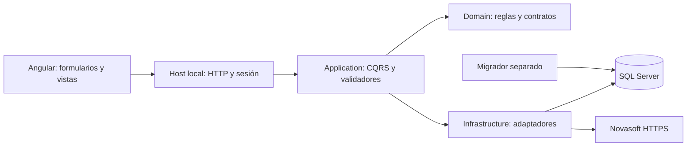
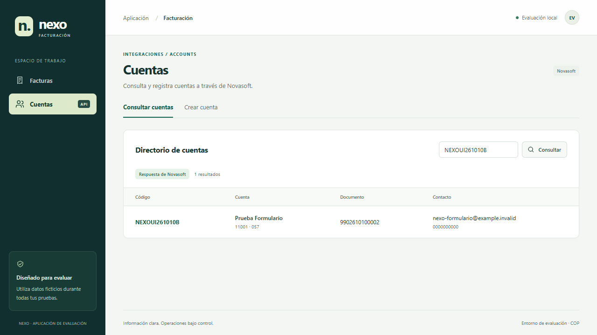

# Nexo · Facturación y Accounts

Aplicación de facturación con **Angular, C# y SQL Server**, e integración con el servicio de pruebas **Novasoft**. Incluye ejecución local automatizada, código fuente, documentación de arquitectura y evidencias reproducibles.

**Angular 22.2.2** · **.NET 10** · **SQL Server 2022** · **Docker Compose**

[Evaluar la aplicación](docs/evaluator-guide.md) · [Arquitectura](docs/ARCHITECTURE.md) · [Decisiones](docs/decisions.md) · [Resultados y evidencias](docs/evidence/README.md) · [DevSecOps](SECURITY.md)

## Qué resuelve

- Formulario HTML5 de facturación con datos del cliente y uno o varios artículos.
- Validación de campos, cálculo de descuento e IVA y vista previa calculada por el backend.
- Guardado transaccional de cabecera y detalle, consecutivo SQL y consulta paginada.
- Idempotencia para reintentos de guardado y persistencia después de reiniciar.
- Consulta y creación de cuentas en Novasoft mediante C#, con credenciales y token sólo en el servidor.

## Evaluación en Windows

El paquete **Aplicacion-1.0.2-local.2.zip**, suministrado junto con la carpeta de entrega para SharePoint, incluye binarios compilados, fuentes, scripts y backup de esquema vacío. La descarga de código de GitHub sirve para revisar o desarrollar; el ZIP de aplicación es el paquete preparado para ejecutar.

1. Abra Docker Desktop con contenedores Linux y Compose funcionando.
2. Verifique el SHA-256 del ZIP y extráigalo en una carpeta local.
3. Ejecute `iniciar.cmd` en la carpeta extraída.
4. Abra `http://127.0.0.1:5080/facturas`.
5. Para Cuentas, ejecute `configurar-novasoft.cmd`, introduzca las credenciales de prueba en privado y reinicie con `detener.cmd` / `iniciar.cmd`.

No requiere Node, SDK .NET ni Visual Studio para ejecutar el paquete. El primer inicio descarga las imágenes oficiales; Novasoft requiere conectividad al proveedor. [Guía completa y casos de evaluación](docs/evaluator-guide.md).

## Arquitectura



Se conservan las capas y convenciones de Template: Domain, Application, Api e Infraestructure, CQRS/MediatR, FluentValidation, mapper y repositorios. Los adaptadores implementan los contratos del dominio; Domain no depende de infraestructura. Angular utiliza componentes standalone, rutas con lazy loading, Reactive Forms tipados y componentes compartidos para campos, errores e iconos.

| Decisión | Resultado |
|---|---|
| Calculador único en C# decimal | Preview y guardado usan las mismas reglas monetarias. |
| Validación frontend y backend | Orientación inmediata y comprobación del lado servidor. |
| Transacción e Idempotency-Key | Cabecera/detalles consistentes y reintentos sin duplicar la factura. |
| Guid interno + número INT IDENTITY | Compatibilidad con la plantilla y consecutivo visible requerido. |
| ResponseBase y ProblemDetails normalizados | Errores por campo, código y traceId utilizables por Angular. |
| Tipos desde OpenAPI | Contrato de transporte comprobado entre frontend y backend. |
| Migrador separado del runtime | Permisos administrativos fuera de las solicitudes de la aplicación. |

[Mapa de capas y persistencia](docs/ARCHITECTURE.md) · [Contrato HTTP](docs/implementation-contract.md) · [Justificación de decisiones](docs/decisions.md)

## Verificación de la versión entregada

| Comprobación | Resultado registrado |
|---|---|
| Backend | 155 aprobadas, 0 fallidas, 0 omitidas; incluye 8 integraciones SQL. |
| Frontend | 28 pruebas unitarias y 4 del proxy aprobadas. |
| Navegador con HTTP controlado | 9 recorridos aprobados. |
| Navegador y SQL reales | Creación, consulta y persistencia de factura. |
| Novasoft real | Consulta desde UI; creación autorizada y consulta posterior documentadas por versión. |
| Entrega Windows | Extracción nueva, inicio, backup, restauración y conservación tras reinicio. |

Los informes identifican versión, entorno y alcance. Las respuestas controladas pertenecen a las pruebas; la aplicación usa SQL y Novasoft reales. Consulte [evidencias y trazabilidad](docs/evidence/README.md) para distinguir ejecución local, CI e integración externa.



## DevSecOps

La solución incorpora sesión y protección CSRF, Host/Origin exactos, autorización, CSP, límites de entrada, errores depurados, permisos SQL mínimos y configuración privada de secretos. El flujo de calidad contempla pruebas, auditorías NuGet/npm, Gitleaks, Semgrep, Trivy, SBOM y ZAP baseline.

[Controles y gestión de vulnerabilidades](SECURITY.md) · [Decisión SQL documentada](docs/sql-risk-acceptance.md) · [Workflow de calidad](.github/workflows/quality.yml)

## Navegar por el código

| Ruta | Contenido |
|---|---|
| [Frontend/src/app](Frontend/src/app) | core, shared, facturas y cuentas. |
| [Core/Application](Core/Application) | Casos de uso y validadores. |
| [Core/Domain](Core/Domain) | Entidades, calculador y contratos. |
| [Infraestructure](Infraestructure) | Persistencia EF y adaptador Novasoft. |
| [Api/LocalEvaluation](Api/LocalEvaluation) | Host de la entrega Windows. |
| [Tools/DatabaseMigrator](Tools/DatabaseMigrator) | Inicialización de SQL. |
| [Test](Test) | Pruebas backend y de integración. |
| [scripts](scripts) | Operación y controles de entrega. |

## Desarrollo

Versiones fijadas: SDK .NET **10.0.401**, Node **24.21.0**, npm **11.13.0**. Abra `Example.sln` o ejecute:

```powershell
dotnet restore Example.sln --locked-mode
dotnet build Example.sln --no-restore
dotnet test Example.sln --no-build
npm ci --prefix Frontend
npm run build --prefix Frontend
npm test --prefix Frontend
```

Las integraciones SQL requieren `FACTURACION_TEST_SQL_CONNECTION` hacia un servidor exclusivo de pruebas. [Cómo reproducir la verificación](docs/TESTING.md).

## Documentación

- [Requisitos y cobertura](docs/requirements.md).
- [Guía del evaluador](docs/evaluator-guide.md) y [operación](docs/delivery.md).
- [Arquitectura](docs/ARCHITECTURE.md), [decisiones](docs/decisions.md) y [contrato API](docs/implementation-contract.md).
- [Integración Novasoft](docs/novasoft-real.md).
- [Pruebas](docs/TESTING.md), [evidencias](docs/evidence/README.md) y [seguridad](SECURITY.md).

Desarrollo: **Sebastián Forero · [Sebastian2759](https://github.com/Sebastian2759)**. Basado en la plantilla indicada para la prueba técnica; la procedencia se conserva en la documentación de arquitectura.
